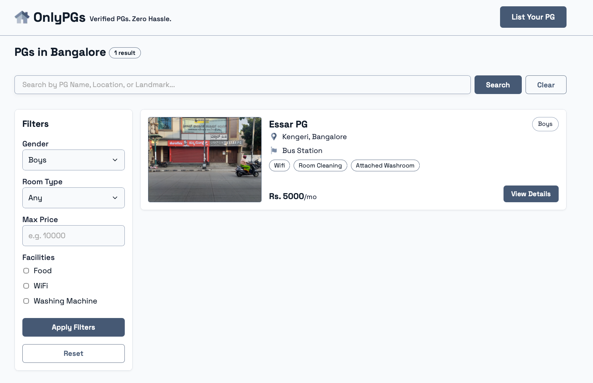

# OnlyPGs

OnlyPGs is a focused platform for finding Paying Guest (PG) accommodation in India without the noise of generic classifieds. Users can browse verified listings by city, search by name or location, compare room options and facilities, and contact owners directly by phone or WhatsApp.

## About OnlyPGs

Our mission is simple: **Real Listings Only. Seamless contact with PG owners.**

OnlyPGs is designed for students and working professionals looking for a home away from home. Each listing is reviewed before it is published, and the platform presents the details that matter when comparing a PG: location, landmark, gender preference, room types, pricing, facilities, rules, photos, and direct contact details.

We are also open to feedback and collaborations that help OnlyPGs grow. For questions, suggestions, or partnership ideas, email [jammyjellyfish26@proton.me](mailto:jammyjellyfish26@proton.me).

## Product Preview

### Find PGs by city


### Search and compare listings



## Features

- Browse PGs by popular city
- Search by PG name, location, or landmark
- Filter by gender, room type, price, and facilities
- Compare room options, pricing, photos, amenities, and rules
- Contact listing providers directly by phone or WhatsApp
- Submit a PG listing for review
- Admin workflow for reviewing and approving listings

## Tech Stack

- [Next.js](https://nextjs.org/) with the App Router
- React and TypeScript
- MongoDB with Mongoose
- AWS S3 for image storage
- Next.js font optimization

## Getting Started

### Prerequisites

- Node.js
- npm
- MongoDB
- AWS S3 credentials for listing photo uploads

### Installation

Clone the repository and install dependencies:

```bash
npm install
```

Create an environment file based on [`env-example`](./env-example):

```bash
cp env-example .env.local
```

Fill in the MongoDB and AWS S3 values in `.env.local`, then start the development server:

```bash
npm run dev
```

Open [http://localhost:3000](http://localhost:3000) in your browser.

## Available Scripts

```bash
npm run dev    # Start the development server
npm run build  # Create a production build
npm run start  # Start the production server
npm run lint   # Run ESLint
```

## Contributing

If you have an improvement, bug fix, or idea for OnlyPGs, please open an issue or submit a pull request. For broader collaboration inquiries, contact [jammyjellyfish26@proton.me](mailto:jammyjellyfish26@proton.me).
